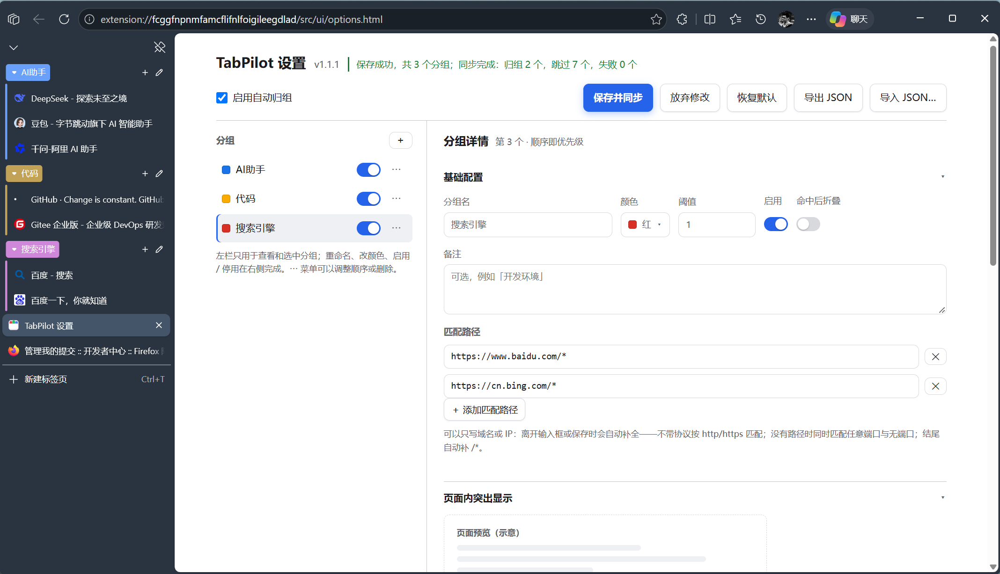
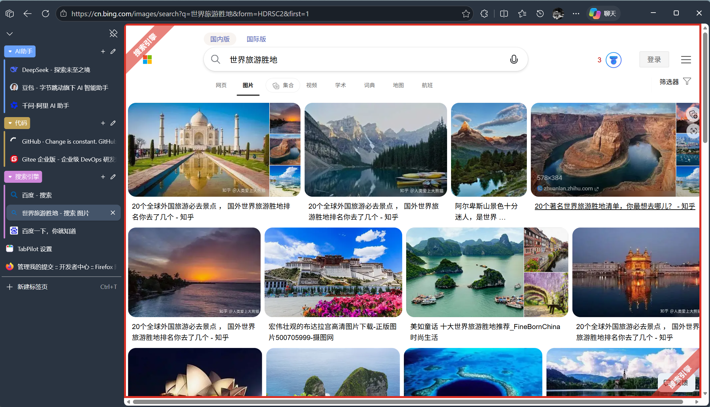
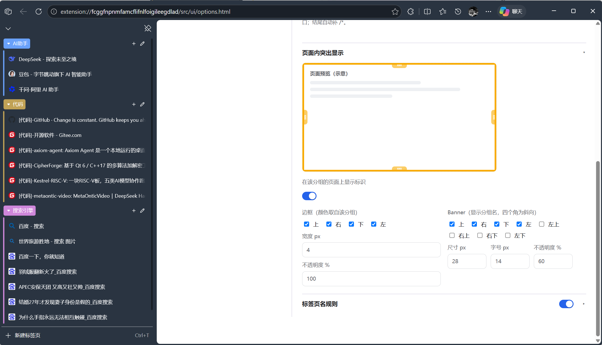
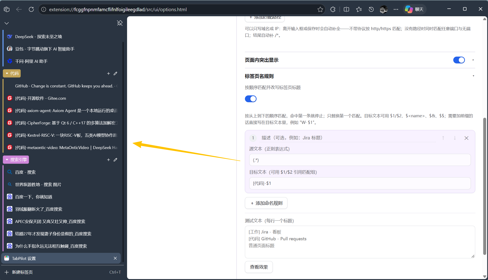
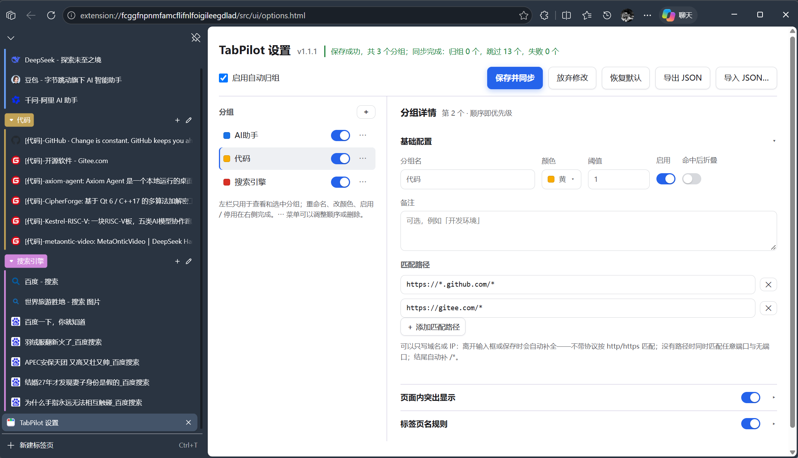

# TabPilot

标签页管理器：按规则自动把页面归入分组、给分组上色，还能在页面内显示分组标识、按规则改写标签页标题。

- **适用**：Firefox 140+、Edge / Chrome（Chromium 116+）
- **运行方式**：纯本地，无网络请求、不上传任何数据
- **配置**：全部在可视化配置页里完成，支持导入 / 导出 JSON
- **界面**：中英双语，默认跟随浏览器语言，也可在配置页手动切换

> 当前源码版本为 **1.3.0**；功能与验收进度见 [开发计划](docs/development-plan.md)。v1.2.0 已发布并完成三浏览器验证，1.3.0 的新增功能验证状态单独记录。

> 从源码构建、调试及发布见 [CONTRIBUTING.md](CONTRIBUTING.md)；产品需求与验收见 [docs/PRD.md](docs/PRD.md)。

---

## 安装

可从下列商店条目安装，也可使用本地文件。Firefox 和 Edge 商店均已上架 1.2.0；本文所述 1.3.0 新功能仍以源码及验收记录为准。

### Firefox

**商店安装**：[TabPilot — Firefox AMO](https://addons.mozilla.org/zh-CN/firefox/addon/tabpilot-firefox/)（版本：**1.2.0**）。

**从文件安装已签名版本**：

1. 打开 `about:addons`
2. 右上角齿轮 → **从文件安装附加组件**
3. 选择签名后的 `.xpi`

> 正式版 Firefox 只接受已签名的扩展，未签名的包无法安装。

### Edge

**商店安装**：[TabPilot — Microsoft Edge Add-ons](https://microsoftedge.microsoft.com/addons/detail/tabpilot/cdjpnbjccmeddhagmbbgjcckjfnofbbn)（版本：**1.2.0**）。

**从 zip 包解压安装**：

1. 解压 `tabpilot-<version>-chromium.zip` 到任意目录
2. 打开 `edge://extensions`
3. 打开「开发人员模式」
4. 点「加载解压缩的扩展」，选择解压后的目录

> Chrome 使用同一个 zip，步骤相同（`chrome://extensions`）。解压后的目录不要删除或移动，否则扩展会失效。

从源码构建、临时加载与调试见 [开发指南](CONTRIBUTING.md#加载与调试)。

## 快速开始

1. 打开配置页：Firefox 可右键点击 TabPilot 图标 → **选项**，也可通过 `about:addons` → TabPilot → **首选项**；Chrome / Edge 是 `chrome://extensions` / `edge://extensions` → TabPilot → **详细信息** → **扩展选项**
2. 左栏默认已有一条「开发」规则（`localhost` → 绿色）。点「＋ ▾」→「新建空白规则」新建分组，在右栏填：
   - **分组名**、**颜色**
   - **匹配路径**（可以只写域名，保存时自动补全）
3. 点顶部 **保存并同步**
4. 打开目标页面，标签页会自动进入对应分组

## 它能做什么

| 能力 | 说明 |
|---|---|
| 自动归组 | 按 URL 规则把新打开的标签页放进指定分组，并设置颜色、是否折叠 |
| 手动补同步 | 已经开着的标签页，保存配置或点工具栏按钮后按规则补处理一遍；点图标的行为可在「全局配置」里设置（含按规则 / 非活动 / 全部折叠） |
| 页面内标识 | 命中分组的页面显示彩色边框和分组名 banner，快速认出「这是哪个环境」 |
| 标签页改名 | 用正则改写标签页标题，支持捕获组重排、加前缀，并可多行测试 |
| 快速建规则 | 复制现有规则，或从当前窗口的手动分组生成规则草稿 |
| 拖拽排序 | 调整左侧规则顺序，保存后改变匹配优先级 |
| 分组置前 | 可选按“固定标签 → 分组 → 游离标签”整理各窗口 |
| 严格模式 | 可选将导航到规则范围外的页面移出当前分组 |
| 手动归组补规则 | 将页面拖入已有规则的分组时，确认后追加网站匹配路径 |
| 备份恢复 | 支持整份替换导入、仅追加分组的追加导入，以及 JSON 导出 |
| 中英双语 | 配置页默认跟随浏览器语言，也可以固定为中文或 English；语言随配置保存，可随 JSON 迁移 |

## 规则与匹配

### 一条规则 = 一个分组

配置页左侧是分组列表，选中某个分组后在右侧编辑。每条规则对应一个标签页分组，可以设置分组名、颜色、匹配路径、阈值、是否折叠，以及页面内标识和标签页名规则。

**分组名在同一份配置里必须唯一**：浏览器原生分组按标题复用，重名会让两条规则落进同一个分组，颜色和折叠互相覆盖。保存 / 导入时会被拒绝，并同时高亮这两个分组。

### 匹配路径

「匹配路径」是一组 URL 模式，**任意一条命中即算命中**，同一个分组可以覆盖多个站点。

路径可以直接写简写，离开输入框或保存时会自动补全：

| 你写的 | 自动补成 | 说明 |
|---|---|---|
| `localhost` | `*://localhost:*/*` 和 `*://localhost/*` | 没有协议 → 同时匹配 http/https；没有路径 → 同时匹配任意端口与无端口 |
| `192.168.0.123` | `*://192.168.0.123:*/*` 和 `*://192.168.0.123/*` | 同上 |
| `localhost:3000` | `*://localhost:3000/*` | 已写端口，不再展开 |
| `https://example.com/foo` | `https://example.com/foo/*` | 结尾自动补 `/*` |
| `https://example.com/foo/*` | 不变 | 已经是完整模式 |

- 展开后只支持 `*` 通配，其余字符按字面量处理。
- `*.github.com` 同时匹配 `github.com` 与所有子域名；不带 `*.` 的 `github.com` 只匹配该主机本身。

### 顺序即优先级

分组列表的顺序就是匹配顺序，**靠上的先匹配**。一个标签页最多进入一个分组。可直接拖拽左栏分组条目调整顺序，也可用 ⋯ 菜单上移 / 下移。拖拽到条目上半部插入其前方，下半部插入其后方；点击「保存并同步」后新优先级才生效。

### 阈值

默认 `1`，即命中就归组。设为 N 时：

- 只有**同一窗口内命中这条规则的标签页数量 ≥ N** 才归组，否则继续尝试后面的规则
- 计数按规则整体统计（一条规则覆盖多个站点时一起算），不按域名分别计数
- 达到阈值时，同窗口内命中该规则、且**还没进任何分组**的标签会被一起归组
- 已经在别的分组里的标签不会被拽出来

### 启用 / 停用

在右栏使用每条规则的「启用」开关，左栏拨杆仅展示状态。1.3.0 已移除扩展内的全局启停开关；旧配置中的 `globalEnabled` 会被忽略并清除。

## 页面内标识

给分组开启后，命中该分组的页面会显示：

- **边框**：上 / 右 / 下 / 左任选，宽度 1–24px，颜色自动取分组颜色，可调不透明度
- **banner**：上 / 下 / 左 / 右四边（贴着边缘的小标签，宽度随文字、靠页内一侧圆角），以及四个角（45° 斜带，两端越过页面边缘被裁掉），显示分组名；尺寸 8–160px、字号 8–32px、不透明度可调
- 边框和 banner 的透明度**分别控制**：边框默认 100%（不透明），banner 默认 60%

配置页顶部有一个 **16:9 示意预览框**：用细条和斜线标出位置，banner 内用 `XXX` 占位，颜色与透明度跟随当前配置，方便调参。

> 新建分组的默认值是「四边边框 + 左上角 banner」，但标识总开关默认关闭——需要手动打开。

## 标签页名规则

每个分组可以配置一组**命名规则**，按顺序匹配当前标签页标题，**命中第一条就停止**：

| 字段 | 说明 |
|---|---|
| 描述 | 仅用于配置页展示 |
| 源文本（正则） | 匹配标题的正则表达式，只替换第一个匹配 |
| 目标文本 | 替换串，支持 `$1`/`$2` 捕获组、`$<name>` 命名组、`$&` 整个匹配、`$$` 字面量 `$`；需要加前缀直接写在这里 |

- 卡片右上角 ↑ / ↓ 调整顺序，✕ 删除；「＋ 添加命名规则」新增
- 底部**测试区域**：每行输入一个标题，点「查看效果」逐行显示替换结果；未匹配的行会标黄提示
- 测试文本会随配置保存，下次打开配置页仍在
- **总开关关闭时整块置灰、不可编辑**，避免配了却不生效
- 页面之后再次修改标题（含单页应用路由切换）会自动重新匹配；关闭规则或分组不再命中时恢复原标题

示例：`^\[工作\]\s*(.*)$` → `W· $1`，把 `[工作] Jira - 看板` 变成 `W· Jira - 看板`。

## 配置页说明

以下截图来自早期界面，当前新增菜单和卡片布局以文字说明为准。

### 左栏：全局配置 + 分组列表

左栏第一行是固定置顶的「全局配置」，点击后在右侧显示设置。下方分组行显示颜色、名称、只读启用状态和 ⋯ 菜单；点击选中后在右侧编辑。

- **新增**：「＋ ▾」→「新建空白规则」，新建颜色按序号在 9 个预设色中循环分配。
- **从窗口生成**：「＋ ▾」→「从当前窗口分组创建规则」，详见下节。
- **复制**：⋯ →「复制」，副本追加到末尾并选中，名称和 id 保证唯一。保留匹配路径、备注、阈值、页面标识与标题规则；颜色按新序号分配，副本默认停用。
- **排序**：直接拖拽，或用 ⋯ 菜单上移 / 下移；规则顺序即优先级。「全局配置」不参与排序。
- **删除**：使用 ⋯ 菜单删除规则。

新增、复制、拖拽和删除仅修改配置页草稿，点击「保存并同步」才生效；可用「放弃修改」撤销。

### 从当前窗口分组创建规则

新增菜单会读取**设置页所在窗口**的原生分组。没有同名规则的命名分组会生成草稿并追加到列表末尾，保留原生名称、颜色与折叠状态，默认启用、阈值为 1，页面标识和标题规则默认关闭。

匹配路径取组内页面的 `协议://主机[:端口]/*`，去掉账号、路径、查询参数和片段，并进行去重。例如 `https://dev.example:8443/app?a=1` → `https://dev.example:8443/*`。

已有同名规则（包括停用规则）会跳过；同名原生分组合并为一条新规则。非 HTTP/HTTPS 页面、固定或游离标签、未命名分组及没有可用网站的分组不会生成规则。重复执行不会重复添加已经在草稿中的分组；现有草稿不被覆盖。

### 右栏：全局配置

语言、图标行为及四个功能开关采用统一卡片，每行两张。扩展内不再提供全局启停开关，需要暂停某类规则时使用分组自身的启用开关。

| 控件 | 行为 |
|---|---|
| 语言 | 自动（跟随浏览器）/ 中文 / English；属于配置，随保存与导入 / 导出 |
| 点击插件图标 | 仅同步 / 同步并按规则折叠 / 同步并折叠非活动分组 / 同步并折叠所有分组；同步覆盖所有窗口，折叠只影响点击时所在的窗口 |
| 自动更新分组规则 | 默认开启；手动拖入已有规则对应分组时，提示是否添加网站匹配路径；关闭后不提示，并清除未处理的确认项 |
| 操作结果提示 | 默认开启；显示图标快捷动作的结果，关闭后仍执行动作，完成即关闭 popup；不影响规则确认表单 |
| 严格模式 | 默认关闭；开启后，分组内页面导航到不匹配当前规则的 HTTP/HTTPS 地址时自动移出；仅处理已启用规则对应的分组，保留固定标签及纯手动分组 |
| 分组置前 | 默认关闭；开启后每次同步按“固定标签 → 分组 → 游离标签”整理，各窗口独立，保留各自相对顺序；自动归组时不重排 |
| 配置管理 | 导出 JSON（仅导出已保存的配置，有未保存修改时不可用）、导入 JSON 并替换当前配置、追加导入（只追加分组）、恢复默认（删除已保存的配置，回到内置默认规则） |

全局配置区以后可以继续增加其他全局选项。

### 右栏：分组详情

三个可独立折叠的区块（折叠状态会记住）：

1. **基础配置**：分组名、颜色、阈值、启用、命中后折叠、备注、匹配路径
2. **页面内突出显示**：开关 + 边框 / banner 配置 + 示意预览
3. **标签页名规则**：开关 + 命名规则卡片 + 多行测试

折叠时标题右侧会显示该区块的状态（启停拨杆），不用展开就能看出有没有配置。

「命中后折叠」有导航例外：当前活动标签已在目标组内，分组已展开，页面跳转或刷新后再次命中原规则时，保持展开；颜色等属性仍正常更新。新标签归组、后台标签以及手动同步/显式折叠动作仍按原设置处理。

### 图标 popup 与设置入口

点击浏览器工具栏的 TabPilot 图标会打开插件弹出面板，并自动执行配置的动作。结果显示 3 秒后，面板内容淡出并自动关闭。鼠标移到「设置」按钮或使用键盘时取消自动关闭；点击「设置」打开配置页。面板不依赖网页内容脚本，在受限页面也能展示结果。关闭「操作结果提示」后，动作执行完成就直接关闭面板。

Firefox 可右键图标 →「选项」打开设置页；Chrome / Edge 使用浏览器默认的右键「选项」入口。

### 拖入分组时添加匹配规则

「自动更新分组规则」默认开启。手动将 HTTP/HTTPS 页面拖入已有 TabPilot 规则对应的分组时，如果该规则还未覆盖此地址，popup 会询问是否加入匹配规则。输入框默认取 `协议://主机[:端口]/*`，可编辑；点击「加入分组」后按配置页相同逻辑补全简写、去重、保存并同步。点击「取消」不修改规则，标签保留在分组里。

没有对应 TabPilot 规则的手动分组保持静默；插件自动归组不触发询问。确认表单不会自动关闭，意外关闭后可再次点击图标继续处理。待确认项优先于图标的默认同步动作。

自动弹出受浏览器限制：Firefox 149+、Chromium 127+ 支持后台打开 popup；旧版本或打开失败时，图标显示待确认角标，点击进入表单。

### 顶部工具栏

| 按钮 | 行为 |
|---|---|
| 保存并同步 | 校验后保存，并立即按规则处理已打开的标签页（仅在有未保存修改时可用） |
| 放弃修改 | 重新从存储加载（仅在有未保存修改时可用） |

- 没有未保存的修改时，两个按钮都置灰不可用
- `Ctrl/Cmd + S` 也能保存，同样只在有修改时生效
- 操作结果提示显示在标题行（插件名与版本号后面），失败时会逐条列出错误并高亮对应分组

## 数据备份与恢复

左栏「全局配置」→ 右侧「配置管理」里的「导出 JSON」，导出的是**已经保存的配置**（含点击行为、语言和所有分组），适合：

- 重载 / 重装扩展前备份
- 换机器时迁移
- 手工编辑后再导入

如果页面上还有未保存的修改，导出按钮会禁用并提示先「保存并同步」或「放弃修改」，避免导出的文件和实际生效的配置不一致。

「追加导入…」只读取 JSON 文件的分组规则，忽略文件中的所有全局设置，分组追加到现有列表末尾。同名时改为「原分组名-导入」，若仍冲突则使用「原分组名-导入-2」等名称；ID 冲突会重新生成。样式、标题规则、备注和启用状态保持原样。

追加导入前会确认并保存当前配置（包括页面上的未保存修改），随后同步。非法文件或取消确认不改变现有配置；原有「导入 JSON…」仍为整份替换。

导入时会校验文件格式；不合法会逐条提示且**不改动现有配置**。旧版本（0.x）导出的文件不兼容，需要重新配置或重新导出。

## 常见问题

### 打开页面没有自动归组？

按顺序检查：

1. 对应分组规则是否已启用
2. 当前 URL 是否命中分组里的某条匹配路径（简写保存后会被展开，可在右栏匹配路径中查看实际模式）
3. 是否设置了「阈值」而当前窗口内命中数量不够
4. 标签页是否已经在**别的**分组里（插件不会把已分组的标签拽走）
5. 页面是保存配置之前就打开的？点一下工具栏的 TabPilot 按钮补同步，或刷新页面

### 页面内标识没有显示？

1. 左栏「全局配置」→「网站访问权限」里的状态是否为“当前没有该权限”？是的话点「申请授权」，授权后刷新页面
2. 确认该分组「页面内突出显示」的开关是开的
3. 确认当前页面命中的就是这个分组
4. 刷新页面
5. 在页面控制台执行 `document.documentElement.dataset.tabpilot`：
   - `on`：标识已注入
   - `title`：该分组只开了标题规则，没有页面内标识
   - `off` / `undefined`：没命中分组，或标识没开启（也可能是没有 host 权限）

### 标签页标题没有变？

1. 确认该分组的「标签页名规则」开关是开的（关闭时配置区会置灰）
2. 用「测试文本」验证规则本身能命中
3. 确认配置已保存
4. **重载扩展后要刷新页面**——content script 只在页面加载时注入
5. 页面控制台会打印 `[TabPilot] 标题已改写：旧 → 新` 或 `标题规则未命中`

### 安装 Firefox 的 zip 时提示「未通过验证」？

正式版 Firefox 只安装已签名的扩展，请使用签名后的 `.xpi`，未签名的包无法安装。Edge / Chrome 的 `tabpilot-<version>-chromium.zip` 需要先解压，再在扩展页加载解压后的目录，不能直接把 zip 拖进浏览器。

### 重启浏览器后配置没了？

正常安装（Firefox 签名 xpi / Edge 解压加载）后配置会保留，只有卸载扩展或清除扩展数据时才会丢失。开发调试时用 Firefox 临时加载的扩展会在浏览器重启后被卸载，这种情况需要先「导出 JSON」备份，重载后再「导入 JSON…」。

### 安装时提示「可访问所有网站的数据」？

页面内标识和标签页改名需要 content script 注入页面，因此 manifest 声明了 `*://*/*` 的 **host 权限**。

- **Firefox**：把 host 权限当作可授予、可撤销的权限，安装时可能没有授予（临时加载、旧版本更新等场景），此时页面内标识和标题改名会**静默失效**。打开配置页左栏的「全局配置」→「网站访问权限」，可以查看状态并用「申请授权」/「取消授权」管理；分组详情里开着相关开关时也会用红色文字提醒。Firefox 中该权限始终可撤销（即使 manifest 只声明 `content_scripts.matches`），配置页的申请 / 取消与 `about:addons` 的权限开关双向同步；授权或撤销后需要刷新已打开的页面。
- **Chrome / Edge**：安装时就把 content script 的站点访问作为必需权限授予，扩展无法通过 API 查询或撤销。需要调整时，在 `chrome://extensions` / `edge://extensions` → TabPilot → 详情 → **站点访问权限**里修改。

插件用网址匹配规则按需读取和改写页面标题；不采集页面正文、不发起网络请求。Firefox 包的 manifest 声明了 `data_collection_permissions.required = ["none"]`。

## 隐私与权限

| 权限 | 用途 |
|---|---|
| `tabs` | 读取标签页的 URL / 标题，把标签页移入分组 |
| `tabGroups` | 创建、更新分组（名称 / 颜色 / 折叠） |
| `storage` | 保存规则配置 |
| `menus`（仅 Firefox） | 在插件图标右键菜单中提供“选项”入口 |
| `*://*/*`（Firefox 为可选 host 权限，Chromium 安装时授予） | 在命中分组的页面上绘制标识、改写标题；Firefox 未授权时配置页会提示并引导授权 |

- 没有任何网络请求，不上传数据，无统计 / 遥测
- 页面内标识是 `pointer-events: none` 的覆盖层，不拦截点击
- 配置只存在本机 `browser.storage.local`

## 已知限制

- 支持 **Firefox 140+** 与 **Edge / Chrome（Chromium 116+）**；Chromium 侧是新支持的平台，`tabGroups` 的折叠等细节可能与 Firefox 略有差异
- 页面内标识在少数强制改写 `z-index` 或使用顶层 iframe 的页面可能被遮住
- 标签页改名靠改 `document.title`：页面自己反复改标题时会跟着重新应用；正则**不支持标志位**（固定区分大小写、只替换第一个匹配），需要忽略大小写可以用 `[Jj]ira` 这种写法
- 不区分 Firefox 容器（Container Tabs）：同一 URL 在不同容器里仍进同一分组
- 规则归组和页面效果不处理 `about:`、扩展商店等受限页面；图标 popup 仍可使用
- 严格模式只处理导航后的 HTTP/HTTPS 地址，内部页和临时空白页不触发移出；关闭的规则、无对应规则的手动组和固定标签保持不变
- 浏览器归组事件不标明是否来自拖动，其他扩展的归组也可能触发补规则询问；本插件的自动归组已排除
- 1.3.0 导出的配置不再含旧版必需的 `globalEnabled`，回退到旧版前请保留旧备份；本版可以读取旧版 schemaVersion 1 配置

## 致谢

本项目的功能与交互设计从以下浏览器扩展中获得启发，感谢作者们的分享：

- **Tab Rename** —— 启发了「标签页标题可以按需改写」的思路。
  [AMO](https://addons.mozilla.org/zh-CN/firefox/addon/tab-rename/) ·
  [GitHub](https://github.com/trickypr/tab-rename)
- **Auto Tab Groups** —— 启发了「按地址匹配规则自动分组」的设计。
  [AMO](https://addons.mozilla.org/zh-CN/firefox/addon/auto-tab-groups/) ·
  [GitHub](https://github.com/nitzanpap/auto-tab-groups)
- **TabTint** —— 启发了「用页面边框标识当前环境」的呈现方式。
  [AMO](https://addons.mozilla.org/zh-CN/firefox/addon/tabtint/)
- **Environment Marker** —— 启发了「在页面上添加彩色标签」的视觉形式。
  [AMO](https://addons.mozilla.org/zh-CN/firefox/addon/environment-marker-extension/)

以上项目仅作为设计与功能上的参考；本项目为独立实现，未复制或包含它们的源代码。

## 许可证

[MIT](LICENSE)
